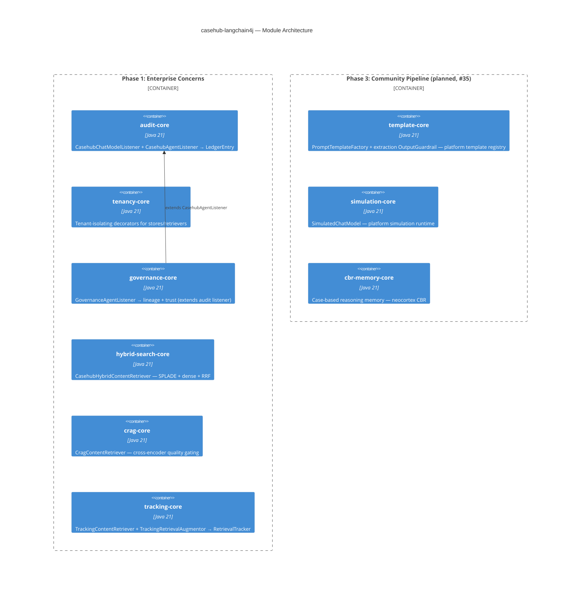
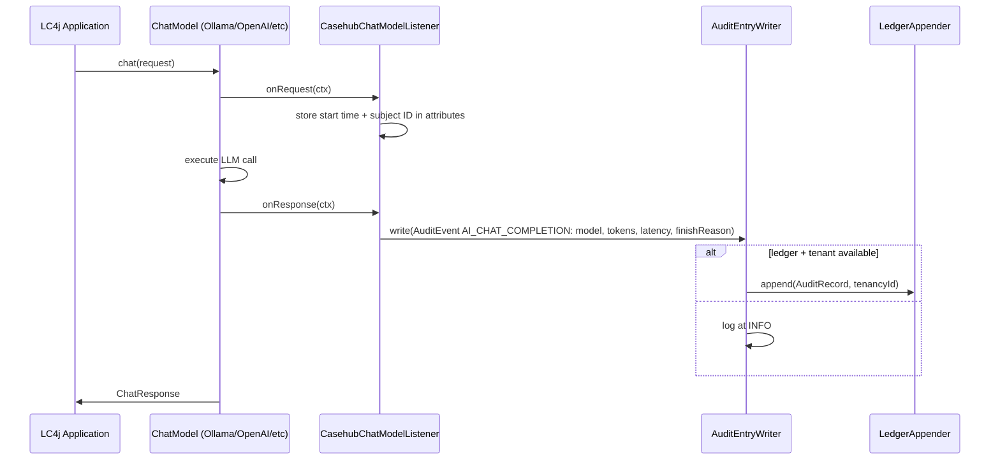
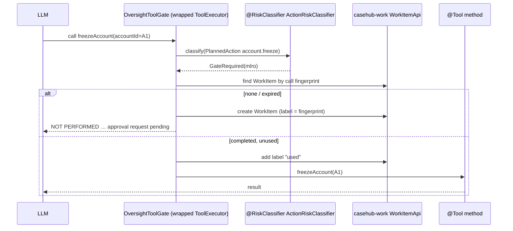
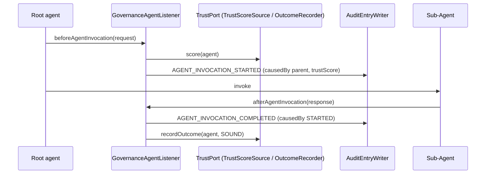
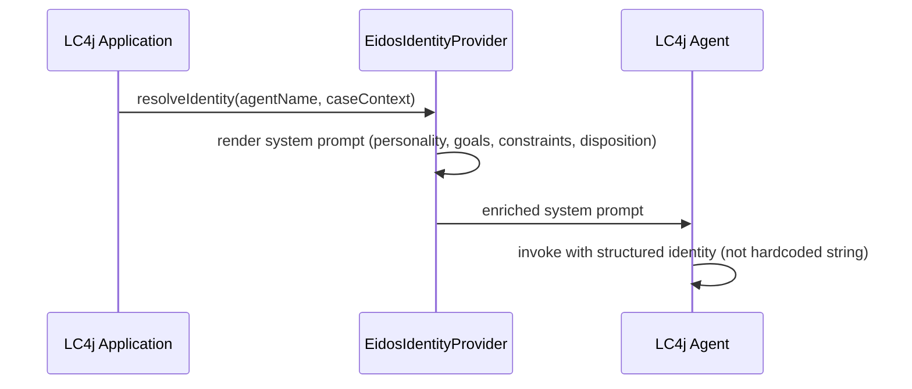
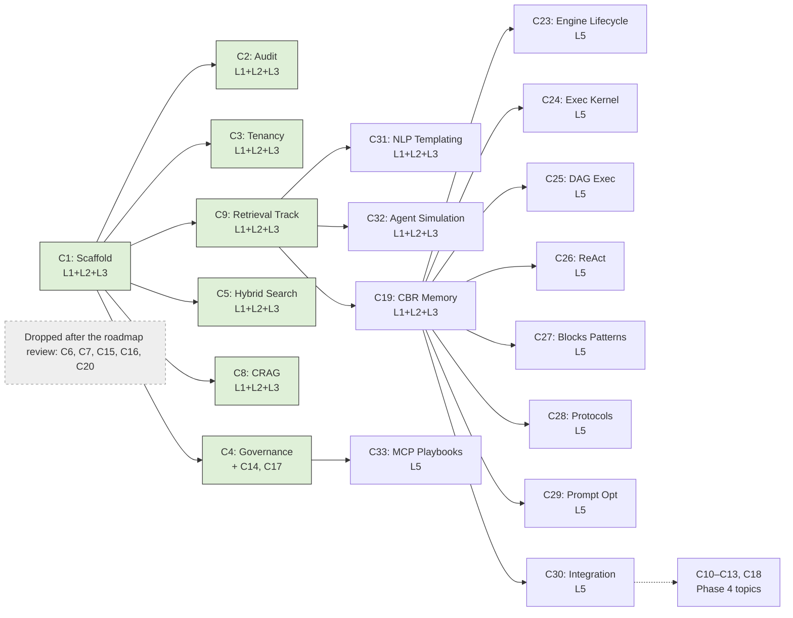

# casehub-langchain4j — ARC42STORIES.MD

**Spec:** Arc42Stories v0.1
**Profile:** CaseHub — Integration tier
**Profile ref:** `../parent/docs/arc42stories-casehub-profile.md` · fallback: `https://raw.githubusercontent.com/casehubio/parent/main/docs/arc42stories-casehub-profile.md`
**Build position:** Integration tier — depends on platform, ledger, neocortex, engine, eidos, qhorus, work, agency. No downstream casehubio dependents.
**Consumed by:** Application-tier repos (aml, clinical, devtown, soc, life) and external LC4j developers
**Depends on:** casehub-platform, casehub-ledger, casehub-neocortex, casehub-engine, casehub-eidos, casehub-qhorus, casehub-work, casehub-agency, langchain4j-core, langchain4j-agentic

---

## §1 Introduction and Goals

### Description

`casehub-langchain4j` provides enterprise enrichment for LangChain4j applications. It is **complementary** to langchain4j, not competitive. The developer keeps their chosen LC4j providers, stores, and patterns. CaseHub adds enterprise concerns that langchain4j deliberately does not handle.

Four phases, each telling a clear story to an LC4j developer:

1. **"Your LC4j app is now enterprise-class"** — audit trails, tenant isolation, governance (oversight gate on tool calls, trust, lineage), hybrid search, CRAG quality gating, retrieval tracking. Decorators and classpath activation.
2. **"Your LC4j agents are now real distributed agents"** — *reframed in #32.* Human-in-the-loop approval and oversight shipped inside Phase 1 governance (C4); query expansion and NLI hallucination detection were dropped; eidos identity, qhorus channels and ledger peer trust moved to Phase 4. No chapters remain in this phase.
3. **"Your LC4j app gets capabilities nothing else on the JVM offers"** — the community pipeline (epic #35): NLP template rendering and extraction, deterministic agent simulation, CBR memory, governed MCP playbooks. These depend on neocortex and platform modules that run standalone, not on the full CaseHub platform.
4. **"Your LC4j agents are orchestrated by CaseHub"** — case lifecycle, execution kernel, DAG dispatch, orchestration patterns, plus eidos identity, qhorus channels and peer trust as reference-architecture topics. Full platform integration.

**Strategic positioning:** This work is designed for complementary engagement with the LC4j community. Phases 1 and 3 demonstrate value that doesn't threaten LC4j's core. The conversation opens with "here's what we built on top of your framework." Phase 4 is where natural migration happens — the developer has seen enough value that they want the full stack.

**Community funnel (#32):** an LC4j developer discovers the [distributions](https://github.com/casehubio/distributions) MCP server (130+ connector tools and neocortex corpus management, usable from any agent runtime) → adds casehub-langchain4j for enterprise trust on those calls (audit, governance, tenancy) → adds RAG quality (CRAG, hybrid search, tracking) and the Phase 3 modules → moves to the full platform (Phase 4).

Module structure per SPI: `-core` (pure Java), bare name (Quarkus CDI), `-spring` (Spring auto-config). The ChatModel ↔ AgentProvider bridge once planned for this repo was retired in platform#638; consumers call `AgentProvider` directly.

### Artifact Schema

| Artifact type | Format | Example | Where it lives |
|---|---|---|---|
| Issue | `#NNN` or `casehubio/casehub-langchain4j#NNN` | `#1` | GitHub Issues |
| ADR | `ADR-NNNN` | `ADR-0001` | `docs/adr/` |
| Design spec | `YYYY-MM-DD-topic-design` | `2026-09-24-phase-1-enterprise-concerns` | workspace `specs/` |
| Blog entry | `YYYY-MM-DD-[initials]NN-title` | `2026-10-01-dt01-title` | workspace `blog/` |

Integration tier uses issue refs directly — no improvement log prefix.

### Stakeholders

| Stakeholder | Interest |
|---|---|
| LangChain4j application developers | Gain enterprise capabilities without rewriting — add a dependency, get audit/tenancy/governance/identity |
| CaseHub application-tier repos | Consume LC4j agents as governed CaseHub workers |
| LangChain4j community (Mario Fusco et al.) | Complementary ecosystem — enterprise capabilities that make LC4j viable for regulated industries |
| Platform team | Agent bridge correctness after migration from platform |

### Quality Goals

| Goal | Scenario |
|---|---|
| Zero forced migration | A developer using vanilla LC4j must not be required to change any code to gain enterprise enrichment |
| Complementary positioning | No module competes with an LC4j core capability without documented justification |
| Graceful degradation | Every module degrades gracefully when optional CaseHub dependencies are absent |
| Both frameworks | Quarkus and Spring supported from day one for every module |

---

## §2 Constraints

### Platform

Java 21 (on Java 26 JVM), Quarkus 3.39.3, LangChain4j 1.19.0. Both Quarkus and Spring Boot supported. Published to GitHub Packages as `io.casehub.langchain4j:casehub-langchain4j-*:0.2-SNAPSHOT`.

```bash
JAVA_HOME=$(/usr/libexec/java_home -v 26) mvn clean install
```

### Dependencies

Resolved from GitHub Packages: `https://maven.pkg.github.com/casehubio/*`. CI authentication via `GITHUB_TOKEN`.

### Module-tier rules

- `*-core/` — pure Java, zero framework deps. No Quarkus, no Spring, no CDI annotations.
- `*/` (bare name) — Quarkus CDI wiring. `@DefaultBean`/`@Alternative @Priority` for classpath activation.
- `*-spring/` — Spring `@Configuration` with `@ConditionalOnClass` for classpath activation.

### Expansion policy

Any module beyond Phase 1 requires documented justification in its README under "## Why this module exists":
1. **Gap acknowledged** — cite an LC4j issue where maintainers acknowledge the gap
2. **Different category** — the module provides something LC4j doesn't attempt
3. **Customer requested** — a CaseHub deployer needs it

---

## §3 Context and Scope

```mermaid
C4Context
  title casehub-langchain4j — System Context

  Person_Ext(lc4jDev, "LC4j Developer", "Uses langchain4j for LLM apps")

  System_Boundary(clc4j, "casehub-langchain4j") {
    System(phase1, "Phase 1: Enterprise Concerns", "Audit, tenancy, governance + oversight gate, hybrid search, CRAG, retrieval tracking")
    System(phase3, "Phase 3: Community Pipeline", "NLP templating, agent simulation, CBR memory, MCP playbook guide")
    System(phase4, "Phase 4: Platform Orchestration", "Engine lifecycle, agency patterns, eidos, qhorus, peer trust")
  }

  System_Ext(lc4j, "langchain4j", "ChatModel, EmbeddingStore, ContentRetriever, AiService, agentic patterns")
  System_Ext(platform, "casehub-platform", "AgentProvider, CurrentPrincipal, identity")
  System_Ext(ledger, "casehub-ledger", "CaseLedgerEntry, trust scoring, attestation")
  System_Ext(neocortex, "casehub-neocortex", "RAG pipeline, CBR memory, ONNX inference")
  System_Ext(engine, "casehub-engine", "Case lifecycle, execution kernel, resilience")
  System_Ext(eidos, "casehub-eidos", "Agent identity, personality, epistemic confidence")
  System_Ext(qhorus, "casehub-qhorus", "Channels, deliberation, normative commitments")
  System_Ext(work, "casehub-work", "WorkItem, SLA, escalation, human review")
  System_Ext(agency, "casehub-agency", "Orchestration patterns, attestation, oversight")

  Rel(lc4jDev, lc4j, "builds with")
  Rel(lc4jDev, clc4j, "adds enterprise enrichment")
  Rel(phase1, lc4j, "wraps — decorators")
  Rel(phase1, platform, "tenancy via CurrentPrincipal")
  Rel(phase1, ledger, "audit via CaseLedgerEntry")
  Rel(phase1, neocortex, "hybrid search, CRAG, retrieval tracking")
  Rel(phase1, engine, "risk classification for the oversight gate")
  Rel(phase1, work, "tool-call approvals")
  Rel(phase3, platform, "template registry, simulation runtime")
  Rel(phase3, neocortex, "CBR memory")
  Rel(phase4, eidos, "agent identity")
  Rel(phase4, qhorus, "typed channels")
  Rel(phase4, agency, "orchestration patterns")
```

**Boundary rules:** casehub-langchain4j adds enterprise concerns to LC4j. It does not replace LC4j's core capabilities (model providers, stores, patterns). Domain logic and application-specific workflows belong in application-tier repos. See `STRATEGY.md` for the full positioning.

---

## §4 Solution Strategy

### Core architectural patterns

- **Decorator over replacement** — three of four Phase 1 modules wrap existing LC4j SPI implementations. The developer keeps their chosen providers. CaseHub adds a cross-cutting concern on top.
- **Classpath activation** — Quarkus: `@DefaultBean`/`@Alternative @Priority`. Spring: `@ConditionalOnClass`. Adding the dependency is the only step.
- **Graceful degradation** — every module degrades instead of failing. Ledger present → ledger entries. Ledger absent → log lines.
- **Three-module pattern** — `*-core` (pure Java bridge), bare name (Quarkus CDI), `*-spring` (Spring auto-config). Established CaseHub convention.

### Layer taxonomy

| Layer | Modules | Responsibility |
|---|---|---|
| L1: Bridge Core | `*-core` modules | Pure Java SPI bridges and decorators — no framework deps |
| L2: Quarkus Integration | bare-name modules | CDI `@DefaultBean`/`@Alternative @Priority` wiring |
| L3: Spring Integration | `*-spring` modules | Spring `@ConditionalOnClass` auto-configuration |
| L5: Examples & Guides | `examples/`, `docs/` | Working demonstrations, capability guides, reference architectures |

### Journey and Chapter sequencing rationale

- C1 before all: scaffold establishes the repo and CI pipeline
- C2–C5 can proceed in parallel: audit, tenancy, governance, hybrid-search are independent modules
- C8–C9 after C1: CRAG and tracking extend Phase 1 with neocortex capabilities; C6 and C7 were dropped (#32)
- Phase 2 (C10–C18) was reframed in #32: C14 and C17 shipped inside C4, C15 and C16 were dropped, C10–C13 and C18 moved to Phase 4
- J4 (Phase 3, epic #35) in priority order: C31 NLP templating → C32 agent simulation → C19 CBR memory → C33 MCP playbook guide. Each is independent; C31 and C33 wait on upstream platform/distributions work
- C23–C30 (and the moved C10–C13, C18) after J4: Phase 4 requires the earlier capabilities as building blocks

---

## §5 Building Block View



---

## §6 Runtime View

### Audit listener intercepting ChatModel call



### Oversight gate on a tool call



### Governance listener observing agent invocation

The listener observes; it cannot veto. LangChain4j catches exceptions thrown from `AgentListener`
callbacks and runs the agent anyway, so no approval gate is enforced here.



### Eidos identity enriching LC4j agent (Phase 4 reference architecture)



---

## §7 Deployment View

### How a developer adds casehub-langchain4j

```xml
<!-- Phase 1: just add audit -->
<dependency>
  <groupId>io.casehub.langchain4j</groupId>
  <artifactId>casehub-langchain4j-audit</artifactId>
</dependency>

<!-- add retrieval tracking -->
<dependency>
  <groupId>io.casehub.langchain4j</groupId>
  <artifactId>casehub-langchain4j-tracking</artifactId>
</dependency>

<!-- Or pull in everything -->
<dependency>
  <groupId>io.casehub.langchain4j</groupId>
  <artifactId>casehub-langchain4j-bom</artifactId>
  <type>pom</type>
  <scope>import</scope>
</dependency>
```

No code changes. No configuration. Classpath activation.

---

## §8 Crosscutting Concepts

### Graceful degradation

Every module has a fallback chain:

| Module | Full stack | Partial | Minimal |
|---|---|---|---|
| audit | Ledger + tenant → ledger entries | — | Log lines |
| tenancy | CurrentPrincipal → tenant isolation | — | Passthrough (single-tenant) |
| governance | Ledger trust beans → lineage + trust | — | Lineage only |
| hybrid-search | Neocortex RAG → full pipeline | — | Clear error on first use (an implementation, not a decorator) |
| crag | `RelevanceEvaluator` → graded, filtered retrieval | — | Retrievers unwrapped (WARN) |
| tracking | `RetrievalTracker` → recorded retrievals | — | Retrievers and augmentors unwrapped (INFO) |

### Tenant propagation

`CurrentPrincipal.tenancyId()` flows through all decorators. The tenancy module wraps the developer's existing stores — their Redis, PostgreSQL, Qdrant, whatever — with a tenant-scoping layer. Cross-tenant access is structurally impossible through the decorator.

### Expansion policy

Any module beyond Phase 1 requires documented justification in its README:
1. **Gap acknowledged** — cite an LC4j issue
2. **Different category** — not competing with LC4j
3. **Customer requested** — deployer needs it

---

## §9 Journeys and Chapters

### §9.1 Journey Overview

| Journey | Phase | Description | Chapters | Status |
|---|---|---|---|---|
| J1: Foundation | — | Scaffold, CI, BOM, workspace, docs | C1 | ✅ |
| J2: Enterprise Concerns | 1 | Audit, tenancy, governance, hybrid-search, CRAG, retrieval tracking | C2–C9 | ✅ C2–C5, C8, C9 done; C6, C7 dropped (#32) |
| J3: Distributed Agent Capabilities | 2 | Reframed in #32 — C14, C17 shipped in C4; C15, C16 dropped; C10–C13, C18 moved to J5 | C10–C18 | ↪️ no chapters left |
| J4: Community Pipeline | 3 | NLP templating, agent simulation, CBR memory, MCP playbook guide (epic #35) | C31, C32, C19, C33 (C20 dropped; C21, C22 parked) | 🔲 |
| J5: Platform Orchestration | 4 | Engine case lifecycle + execution kernel + DAG + ReAct, agency patterns + protocols + prompt optimisation, full integration guide; eidos, qhorus and peer trust as reference-architecture topics | C23–C30, C10–C13, C18 | 🔲 |

Status legend: ✅ done · 🔲 planned · ❌ dropped · ↪️ delivered elsewhere or moved · ⏸ parked (not in the current pipeline).

### §9.2 Chapter Index



### §9.3 Chapter Summary Table

| # | Chapter | Journey | Phase | Layers | Status |
|---|---|---|---|---|---|
| 1 | Scaffold | J1 | — | L1, L2, L3 | ✅ |
| 2 | Audit — Ledger + Compliance | J2 | 1 | L1, L2, L3 | ✅ |
| 3 | Tenancy — Tenant Isolation Decorators | J2 | 1 | L1, L2, L3 | ✅ |
| 4 | Governance — Oversight + Trust + Lineage | J2 | 1 | L1, L2, L3 | ✅ (gate on tool calls; Spring approvals via remote casehub-work #15) |
| 5 | Hybrid Search — SPLADE + Dense + RRF | J2 | 1 | L1, L2, L3 | ✅ |
| 6 | Resilience — DLQ + Retry + Watchdog | J2 | 1 | L1, L2, L3 | ❌ dropped (#32) |
| 7 | Concurrency Budget — LLM Cost Control | J2 | 1 | L1, L2, L3 | ❌ dropped (#32) |
| 8 | CRAG Quality Gating — Hallucination Reduction | J2 | 1 | L1, L2, L3 | ✅ |
| 9 | Retrieval Tracking + Analytics | J2 | 1 | L1, L2, L3 | ✅ |
| 10 | Eidos Agent Identity + Personality | J5 | 4 | L5 | ↪️ Phase 4 topic (#32) |
| 11 | Eidos Reputation + Capability Matching | J5 | 4 | L5 | ↪️ Phase 4 topic (#32) |
| 12 | Qhorus Typed Channels | J5 | 4 | L5 | ↪️ Phase 4 topic (#32) |
| 13 | Qhorus Deliberation + Commitments | J5 | 4 | L5 | ↪️ Phase 4 topic (#32) |
| 14 | Work Human-in-the-Loop | J2 | 1 | L1, L2, L3 | ↪️ shipped in C4 (#32) |
| 15 | Neocortex Query Expansion (HyDE, Step-Back) | J3 | 2 | L5 | ❌ dropped → recipe (#32) |
| 16 | Neocortex NLI Hallucination Detection | J3 | 2 | L1, L2, L3 | ❌ dropped (#36) |
| 17 | Blocks Attestation + Oversight | J2 | 1 | L1, L2, L3 | ↪️ shipped in C4 (#32) |
| 18 | Ledger Peer Trust + EigenTrust | J5 | 4 | L5 | ↪️ Phase 4 topic (#32) |
| 19 | CBR Memory | J4 | 3 | L1, L2, L3 | 🔲 #39 |
| 20 | SPLADE Embedding | J4 | 3 | L1, L2, L3 | ❌ dropped (#38) |
| 21 | Corpus Ingestion | J4 | 3 | L1, L2, L3 | ⏸ parked |
| 22 | Temporal/Version Scoring | J4 | 3 | L1, L2, L3 | ⏸ parked |
| 23 | Engine Case Lifecycle | J5 | 4 | L5 | 🔲 |
| 24 | Engine Execution Kernel | J5 | 4 | L5 | 🔲 |
| 25 | Engine DAG Execution | J5 | 4 | L5 | 🔲 |
| 26 | Engine ReAct Loop | J5 | 4 | L5 | 🔲 |
| 27 | Blocks Orchestration Patterns | J5 | 4 | L5 | 🔲 |
| 28 | Blocks Multi-Agent Protocols | J5 | 4 | L5 | 🔲 |
| 29 | Blocks Prompt Optimisation | J5 | 4 | L5 | 🔲 |
| 30 | Full Platform Integration Guide | J5 | 4 | L5 | 🔲 |
| 31 | NLP Template Rendering + Extraction | J4 | 3 | L1, L2, L3 | 🔲 #37 |
| 32 | Agent Simulation | J4 | 3 | L1, L2, L3 | 🔲 #41 |
| 33 | MCP Playbook Integration Guide | J4 | 3 | L5 | 🔲 #40 |

### §9.4 Chapter Entries

---

#### C1 — Scaffold

**Journey:** J1 | **Sequence:** 1 of 33 | **Status:** ✅

**What this delivers**
The repo exists with Maven multi-module structure, CI pipeline, BOM and workspace. IntelliJ can open the project. `mvn install` passes. The ChatModel ↔ AgentProvider bridge originally planned here was retired in platform#638 and its empty `agents*` modules were removed.

**Key files**

| File | Purpose |
|---|---|
| `pom.xml` | Root POM — parent, modules, dependency management |
| `bom/pom.xml` | BOM importing all published modules |
| `.github/workflows/publish.yml` | CI: build on PR, deploy on push, dispatch downstream |
| `CLAUDE.md` | Project type java, work tracking enabled |
| `ARC42STORIES.MD` | This file |
| `STRATEGY.md` | Complementary positioning and expansion policy |

**Issues**
- #4 — baseline: versions, test infrastructure, spec links
- #5 — remove agents bridge modules (retired in platform#638)
- #1 — CI SNAPSHOT deploy (closed)

---

#### C2 — Audit: Ledger + Compliance (Phase 1)

**Journey:** J2 | **Sequence:** 2 of 33 | **Status:** ✅
**Spec:** `2026-09-24-phase-1-enterprise-concerns.md` §audit

**What this delivers**
Every LLM call and every agent invocation produces a ledger entry (`AuditRecord` via `LedgerAppender`), or a log line when no ledger is present. LLM-call audit is classpath-activated; the agent listener is attached to the root agent with one line. Token usage and latency are recorded. Not delivered: `ComplianceSupplement` (the ledger append API has no slot for it) and cost estimates (no pricing source).

**Key files**

| File | Purpose |
|---|---|
| `audit-core/.../CasehubChatModelListener.java` | Implements `ChatModelListener` — onRequest/onResponse/onError → LedgerEntry |
| `audit-core/.../CasehubAgentListener.java` | Implements `AgentListener` (inheritedBySubagents=true) — agent invocation audit |
| `audit-core/.../AuditEntryWriter.java` | SPI for writing audit entries — ledger (`LedgerAuditEntryWriter`) and logging implementations |
| `audit/.../AuditBeans.java` | CDI @Produces for listeners with graceful degradation |
| `audit-spring/.../AuditAutoConfiguration.java` | @ConditionalOnClass auto-configuration |

**Issues**
- #6 — audit-core: chat model and agent invocation audit
- #7 — Quarkus CDI and Spring wiring

---

#### C3 — Tenancy: Tenant Isolation Decorators (Phase 1)

**Journey:** J2 | **Sequence:** 3 of 33 | **Status:** ✅
**Spec:** `2026-09-24-phase-1-enterprise-concerns.md` §tenancy

**What this delivers**
Any `ChatMemoryStore`, `EmbeddingStore`, or `ContentRetriever` becomes multi-tenant. The developer's chosen implementation (Redis, PostgreSQL, Qdrant, whatever) is preserved inside the decorator. Tenant ID from `CurrentPrincipal.tenancyId()`.

**Key files**

| File | Purpose |
|---|---|
| `tenancy-core/.../TenantIsolatingChatMemoryStore.java` | Decorates ChatMemoryStore — scopes memoryId by tenant |
| `tenancy-core/.../TenantIsolatingEmbeddingStore.java` | Decorates EmbeddingStore — tenant filter on search, tenant tag on add |
| `tenancy-core/.../TenantIsolatingContentRetriever.java` | Decorates ContentRetriever — tenant filter on retrieve |
| `tenancy/.../TenancyBeans.java` | CDI: discovers existing beans, wraps with tenant decorators |
| `tenancy-spring/.../TenancyAutoConfiguration.java` | Spring: BeanPostProcessor wrapping |

**Issues**
- #8 — tenant-isolating decorators for all three SPIs, with isolation tests
- #9 — Quarkus CDI and Spring wiring

---

#### C4 — Governance: Oversight + Trust + Lineage (Phase 1)

**Journey:** J2 | **Sequence:** 4 of 33 | **Status:** ✅
**Spec:** `2026-09-24-phase-1-enterprise-concerns.md` §governance

**What this delivers**
Delivered via `AgentListener`: causal lineage (shared with audit — `GovernanceAgentListener` extends `CasehubAgentListener`), the agent's trust score on each STARTED entry, and a trust outcome (`SOUND` / `FLAGGED`) for every invocation. **Oversight gate:** an `AgentListener` cannot block (LangChain4j swallows listener exceptions), so the gate wraps the agent's tool executors (`OversightToolGate`): each call is classified by engine's `@RiskClassifier ActionRiskClassifier` beans and a call needing approval runs only after a casehub-work WorkItem for that exact call is completed, once. Trust-weighted routing is still not delivered — the score is recorded, not acted on.

**Key files**

| File | Purpose |
|---|---|
| `governance-core/.../GovernanceAgentListener.java` | Extends `CasehubAgentListener` — lineage + trust score + outcomes (no gate) |
| `governance-core/.../TrustPort.java`, `LedgerTrustPort.java` | Trust port and its ledger adapter |
| `governance-core/.../gate/WorkItemApprovalPort.java`, `WorkItemApiGateway.java`, `HttpWorkItemGateway.java` | Approval port over casehub-work — in-process `WorkItemApi` or remote REST (`WorkTokenProvider` picks the token per tenant) |
| `governance/.../GovernanceBeans.java` | CDI: produce the listener with optional ledger trust beans |
| `governance-spring/.../GovernanceAutoConfiguration.java` | Spring auto-configuration |

**Issues**
- #10 — lineage + trust; oversight gate on tool calls (`OversightToolGate`, design `docs/superpowers/specs/2026-11-20-tool-oversight-gate-design.md`)
- #15 — Spring Boot approvals over casehub-work REST (`HttpWorkItemGateway`, design `docs/superpowers/specs/2026-11-22-remote-work-approval-design.md`); in-process Spring waits on casehubio/work#436
- #11 — Quarkus CDI and Spring wiring

---

#### C5 — Hybrid Search: SPLADE + Dense + RRF (Phase 1)

**Journey:** J2 | **Sequence:** 5 of 33 | **Status:** ✅
**Spec:** `2026-09-24-phase-1-enterprise-concerns.md` §hybrid-search
**Justification:** LC4j issue #4087 — acknowledged gap, no LC4j solution

**What this delivers**
`ContentRetriever` implementation with neocortex's full hybrid retrieval pipeline: SPLADE sparse embeddings, dense vector embeddings, Reciprocal Rank Fusion (Qdrant server-side), optional cross-encoder reranking. 26–31% NDCG improvement over dense-only.

**Key files**

| File | Purpose |
|---|---|
| `hybrid-search-core/.../CasehubHybridContentRetriever.java` | Implements ContentRetriever — delegates to CaseContextRetriever |
| `hybrid-search/.../HybridSearchBeans.java` | CDI wiring |
| `hybrid-search-spring/.../HybridSearchAutoConfiguration.java` | Spring auto-configuration |

**Issues**
- #12 — CasehubHybridContentRetriever, mapping, Quarkus and Spring wiring
- Not done: integration test with Testcontainers Qdrant

---

#### C6 — Resilience: DLQ + Retry + Watchdog (Phase 1)

**Journey:** J2 | **Sequence:** 6 of 33 | **Status:** ❌ Dropped (#32)

**Decision (#32):** dropped. STRATEGY says wait for upstream (Quarkus WG 50582), and engine's resilience classes operate on `CaseInstance`/`CaseInstanceCache`, not on LC4j calls. A narrow need that emerges later (e.g. dead-lettering failed tool calls through the governance gate) is a small addition to the governance module, not a chapter.

*Original scope:* dead letter queue, retry policies and a watchdog for agent tool calls, bridged from engine's `DeadLetterQueue`, `RetryPolicy`, `PoisonPillDetector`, `WatchdogRecoveryBridge`.

---

#### C7 — Concurrency Budget: LLM Cost Control (Phase 1)

**Journey:** J2 | **Sequence:** 7 of 33 | **Status:** ❌ Dropped (#32)

**Decision (#32):** dropped — fails D8 on all three criteria, and no deployer has asked. A `Semaphore`-wrapping `ChatModel` decorator is a few lines in the application.

*Original scope:* limit concurrent agents for LLM cost control via engine's `DispatchBudget`.

---

#### C8 — CRAG Quality Gating: Hallucination Reduction (Phase 1)

**Journey:** J2 | **Sequence:** 8 of 33 | **Status:** ✅

**What this delivers**
Corrective RAG — automatically discards low-relevance chunks before the LLM sees them. Uses neocortex's cross-encoder to score chunk relevance and remove noise. Reduces hallucination by preventing the LLM from reasoning over irrelevant context.

**Key classes:** `CragContentRetriever` — wraps any ContentRetriever, grades with neocortex's `RelevanceEvaluator` (cross-encoder, ColBERT or custom), drops INCORRECT, puts CORRECT first; `CragRetrievalQuality` event. Composes with tenancy as CRAG(Tenancy(app)). No search expansion (`ContentRetriever` has no result-count parameter). Design: `docs/superpowers/specs/2026-11-20-crag-filter-design.md`.

**Issues**
- #17 — CRAG quality filter (core + quarkus + spring)

---

#### C9 — Retrieval Tracking + Analytics (Phase 1)

**Journey:** J2 | **Sequence:** 9 of 33 | **Status:** ✅

**What this delivers**
Every RAG retrieval is recorded with provenance — what was retrieved, for which query, from which corpus. Query clustering, document impact centrality, zero-hit detection. Observability for RAG that LC4j does not provide. Classpath-activated from neocortex's tracking infrastructure.

**Key classes:** `TrackingContentRetriever` — wraps any ContentRetriever, records each retrieval into neocortex's `RetrievalTracker` (documents by `source_document_id`), stamps `retrieval_id` for feedback, publishes `RetrievalRecorded`; never changes or fails a retrieval. `TrackingRetrievalAugmentor` (#28) records once per question when the augmentor rewrites queries (retrievers inside stand down; wrapped automatically in Spring and Quarkus). `RetrievalIdAwareContentAggregator` (opt-in, #24) keeps LangChain4j's passage de-duplication working in multi-retrieval pipelines despite the stamps. Composes as Tracking(CRAG(Tenancy(app))). Analytics: neocortex's `RetrievalAnalyzer` used directly. Tracker: neocortex's `SqliteRetrievalTracker` (`rag-tracking` in Quarkus, `rag-tracking-spring` in Spring Boot) or an application bean. Design: `docs/superpowers/specs/2026-11-20-retrieval-tracking-design.md`.

**Issues**
- #19 — retrieval tracking (core + quarkus + spring)
- #20 — Spring-friendly SQLite tracker ✅ (upstream: neocortex#1200)
- #24 — passage de-duplication with retrieval IDs ✅
- #28 — one record per question at the augmentor

---

#### C10 — Eidos Agent Identity + Personality (Phase 4, moved from Phase 2)

**Journey:** J5 | **Sequence:** 10 of 33 | **Status:** ↪️ Moved to Phase 4 (#32)
**Decision (#32):** moved to Phase 4 as a reference-architecture topic (with C23–C30), not a standalone module — it needs eidos/qhorus/ledger as hard dependencies, which is CaseHub platform integration rather than LC4j enrichment. Scope below is the original plan.
**Justification:** Different category — LC4j agents are identity-less (prompt string). Eidos provides structured identity.

**What this delivers**
LC4j agents go from hardcoded system prompt strings to dynamically rendered identities. Personality from 48 sub-archetypes (Hartwell & Chen), MBTI/DISC/Jungian profiles, weighted disposition axes. Goals, constraints, and epistemic domains render per invocation context. The same agent code behaves differently depending on the case.

**Key capabilities:** `SystemPromptRenderer`, `PersonalityComposition`, `AgentGoals`, `AgentConstraints`, `Disposition`, archetype-driven personality configuration.

**Issues**
- TBD — eidos identity bridge module (core + quarkus + spring)
- TBD — SystemPromptRenderer ↔ LC4j system message integration
- TBD — example: same agent, two personalities, different behaviour

---

#### C11 — Eidos Reputation + Capability Matching (Phase 4, moved from Phase 2)

**Journey:** J5 | **Sequence:** 11 of 33 | **Status:** ↪️ Moved to Phase 4 (#32)
**Decision (#32):** moved to Phase 4 as a reference-architecture topic (with C23–C30), not a standalone module — it needs eidos/qhorus/ledger as hard dependencies, which is CaseHub platform integration rather than LC4j enrichment. Scope below is the original plan.

**What this delivers**
LC4j agents are selected by what they can do, not by name. Capability health probing — agent self-reports whether its declared capabilities are operable. Subsumption matching (OWLS-MX match degrees: Exact > Plugin > Specialization) for agent selection. Epistemic confidence via ScalarRegressor — the agent knows how confident it should be.

**Key capabilities:** `CapabilityHealthProbe`, subsumption matching, `ScalarRegressor` epistemic confidence.

**Issues**
- TBD — eidos reputation bridge module

---

#### C12 — Qhorus Typed Channels (Phase 4, moved from Phase 2)

**Journey:** J5 | **Sequence:** 12 of 33 | **Status:** ↪️ Moved to Phase 4 (#32)
**Decision (#32):** moved to Phase 4 as a reference-architecture topic (with C23–C30), not a standalone module — it needs eidos/qhorus/ledger as hard dependencies, which is CaseHub platform integration rather than LC4j enrichment. Scope below is the original plan.
**Justification:** Different category — LC4j has no inter-agent communication framework. Agents call each other via method invocations.

**What this delivers**
Structured inter-agent messaging with 5 channel semantics (APPEND, COLLECT, BARRIER, EPHEMERAL, LAST_WRITE). ACLs, rate limiting, delivery tracking. LC4j agents subscribe to Qhorus channels — messages are auditable, typed, and governed.

**Key capabilities:** `QhorusChannel`, `share_data`/`get_shared_data`, 5 delivery semantics, `MessageLedgerEntry`.

**Issues**
- TBD — qhorus channels bridge module (core + quarkus + spring)
- TBD — AgenticScope ↔ QhorusChannel wiring

---

#### C13 — Qhorus Deliberation + Commitments (Phase 4, moved from Phase 2)

**Journey:** J5 | **Sequence:** 13 of 33 | **Status:** ↪️ Moved to Phase 4 (#32)
**Decision (#32):** moved to Phase 4 as a reference-architecture topic (with C23–C30), not a standalone module — it needs eidos/qhorus/ledger as hard dependencies, which is CaseHub platform integration rather than LC4j enrichment. Scope below is the original plan.

**What this delivers**
Agent messages carry deontic obligations — a PROMISE creates an enforceable commitment, a REQUEST creates an expectation. Violations are detected and recorded. Structured debate with auditable outcomes. No framework anywhere offers this for LLM agents.

**Key capabilities:** Normative commitments (speech-act theory), violation detection, structured debate protocol.

**Issues**
- TBD — qhorus deliberation bridge module

---

#### C14 — Work Human-in-the-Loop (shipped in Phase 1)

**Journey:** J2 | **Sequence:** 14 of 33 | **Status:** ↪️ Shipped in C4 (#32)
**Justification:** Different category — LC4j has no human participation model.

**Decision (#32):** delivered by C4 governance. The oversight gate (`OversightToolGate` + engine's risk classifiers + `WorkItemApprovalPort`, in-process and over casehub-work REST — #10, #15) is the tool-call approval flow this chapter was for. The rest of the original scope (arbitrary work items, SLA lifecycle, M-of-N, delegation) is application-level orchestration, not LC4j enrichment.

---

#### C15 — Neocortex Query Expansion: HyDE, Step-Back (Phase 2)

**Journey:** J3 | **Sequence:** 15 of 33 | **Status:** ❌ Dropped → recipe (#32)

**Decision (#32):** dropped as a module. LangChain4j's `QueryTransformer` covers the rewriting (`ExpandingQueryTransformer`; HyDE and step-back are a few lines), so a bridge module would duplicate it. The real gaps were integration problems, fixed in C9: one record per question at the augmentor (#28) and passage de-duplication despite retrieval IDs (#24).

**Delivered instead:** the recipe `docs/guides/query-rewriting.md` — multi-query, HyDE and step-back with `RetrievalIdAwareContentAggregator` and augmentor tracking — backed by `examples/.../QueryRewritingExample.java` and its offline test.

---

#### C16 — Neocortex NLI Hallucination Detection (Phase 2)

**Journey:** J3 | **Sequence:** 16 of 33 | **Status:** ❌ Dropped (#36)

**Decision:** first kept as the next module in #32, then dropped when #36 was closed — NLI entailment proved unreliable on real LLM output, and the inference infrastructure it needed does not exist in neocortex.

*Original scope:* an `OutputGuardrail` that checks each claim of the answer against the retrieved context with a local ONNX DeBERTa NLI model.

---

#### C17 — Blocks Attestation + Oversight (shipped in Phase 1)

**Journey:** J2 | **Sequence:** 17 of 33 | **Status:** ↪️ Shipped in C4 (#32)

**Decision (#32):** delivered by C4 governance. Oversight is the governance gate on tool calls; trust recording (`GovernanceAgentListener` → `LedgerTrustPort` → `SOUND`/`FLAGGED` outcomes) landed there too. Structured attestation records (`AttestationIntent`/`AttestationWriter` with verdict, evidence and causal chains) are a ledger/agency concern; if needed they join C18's trust work in Phase 4.

---

#### C18 — Ledger Peer Trust + EigenTrust (Phase 4, moved from Phase 2)

**Journey:** J5 | **Sequence:** 18 of 33 | **Status:** ↪️ Moved to Phase 4 (#32)
**Decision (#32):** moved to Phase 4 as a reference-architecture topic (with C23–C30), not a standalone module — it needs eidos/qhorus/ledger as hard dependencies, which is CaseHub platform integration rather than LC4j enrichment. Scope below is the original plan.

**What this delivers**
Other agents (or humans) rate an LC4j agent's outputs as SOUND/FLAGGED/ENDORSED/CHALLENGED. Bayesian Beta trust scores evolve from these attestations. EigenTrust peer verdict aggregation computes global reputation. Agent reputation is earned, not declared.

**Key capabilities:** `TrustSignalProvider`, `AttestationPolicy`, Bayesian Beta algorithm, EigenTrust, capability-scoped + dimension-scoped scores.

**Issues**
- TBD — ledger trust bridge module
- TBD — GDPR Art.17 token-severing erasure support

---

#### C19 — CBR Memory (Phase 3)

**Journey:** J4 | **Sequence:** 19 of 33 | **Status:** 🔲 (#39)
**Justification:** Different category — case-based reasoning, not chat persistence.

**Justification:** Different category — case-based reasoning, not chat persistence.

**What this delivers**
Learn from past cases — similarity-weighted retrieval, outcome feedback loop, plan adaptation, retention policies, trust-weighted retention — bridged from neocortex's `memory-cbr-*` modules, which run standalone. Not a competing `ChatMemoryStore`; a fundamentally different memory paradigm. Where it plugs into LangChain4j (retriever, tool or memory SPI) is the first design question — no LC4j SPI fits CBR directly.

**Issues**
- #39 — CBR memory (core + quarkus + spring)

---

#### C20 — SPLADE Embedding (Phase 3)

**Journey:** J4 | **Sequence:** 20 of 33 | **Status:** ❌ Dropped (#38)
**Justification:** No JVM implementation outside neocortex.

**Decision:** dropped when #38 was closed — SPLADE is an implementation detail inside hybrid search (C5, #12), not a standalone user-facing capability.

---

#### C21 — Corpus Ingestion (Phase 3)

**Journey:** J4 | **Sequence:** 21 of 33 | **Status:** ⏸ Parked
**Justification:** Different category — enterprise document lifecycle (versioning, provenance, change tracking).

**Justification:** Different category — enterprise document lifecycle (versioning, provenance, change tracking).

**What this delivers**
Managed document lifecycle beyond LC4j's basic Tika parsing. Versioned corpus stores, change detection, cursor-based incremental re-indexing, metadata extraction.

Not in the community pipeline (#35); corpus management is reachable today through the distributions MCP server.

---

#### C22 — Temporal/Version Scoring (Phase 3)

**Journey:** J4 | **Sequence:** 22 of 33 | **Status:** ⏸ Parked

**What this delivers**
Post-retrieval score decay by document age or version distance — fresher or newer documents rank higher. Thin composable utility.

Not in the community pipeline (#35).

---

#### C23 — Engine Case Lifecycle (Phase 4)

**Journey:** J5 | **Sequence:** 23 of 33 | **Status:** 🔲

**What this delivers**
Guide + example: LC4j agents as workers in governed case instances. CaseContext, EventLog, Goal model, CasePlanModel, PlanItem. The engine manages when and how agents are invoked.

*Detail expands as Phase 4 approaches.*

---

#### C24 — Engine Execution Kernel (Phase 4)

**Journey:** J5 | **Sequence:** 24 of 33 | **Status:** 🔲

**What this delivers**
Composable routing strategies (5-signal blending: trust + workload + personality + semantic + CBR), stage gating, loop control, SubCase coordination. Beyond LC4j's "supervisor picks the next agent."

*Detail expands as Phase 4 approaches.*

---

#### C25 — Engine DAG Execution (Phase 4)

**Journey:** J5 | **Sequence:** 25 of 33 | **Status:** 🔲

**What this delivers**
Dependency-graph-aware parallel agent dispatch with ANY_OF/ALL_OF join types, contingency nodes. Beyond LC4j's flat `@ParallelAgent`.

*Detail expands as Phase 4 approaches.*

---

#### C26 — Engine ReAct Loop (Phase 4)

**Journey:** J5 | **Sequence:** 26 of 33 | **Status:** 🔲

**What this delivers**
Production-grade reason-act-observe loop with retry, timeout, and tool call tracking. LC4j's ReAct requires manual prompt engineering.

*Detail expands as Phase 4 approaches.*

---

#### C27 — Blocks Orchestration Patterns (Phase 4)

**Journey:** J5 | **Sequence:** 27 of 33 | **Status:** 🔲

**What this delivers**
@Supervisor, @Sequence, @Parallel, @Debate, @Voting annotations with governance meta-annotations (@OversightGate, @TrustRouted, @Attestation). Side by side with LC4j's patterns — CaseHub handles external orchestration, LC4j handles internal agent logic.

*Detail expands as Phase 4 approaches.*

---

#### C28 — Blocks Multi-Agent Protocols (Phase 4)

**Journey:** J5 | **Sequence:** 28 of 33 | **Status:** 🔲

**What this delivers**
Conversation orchestration with turn policies and convergence detection. Negotiation protocols with acceptance policies. Judgment orchestration with fan-out, escalation, and consensus. Coalition formation via capability-based team assembly.

*Detail expands as Phase 4 approaches.*

---

#### C29 — Blocks Prompt Optimisation (Phase 4)

**Journey:** J5 | **Sequence:** 29 of 33 | **Status:** 🔲

**What this delivers**
DSPy-inspired few-shot optimiser (diversity-aware), instruction optimiser (LLM meta-prompting), A/B variant selection. Data-driven prompt improvement.

*Detail expands as Phase 4 approaches.*

---

#### C30 — Full Platform Integration Guide (Phase 4)

**Journey:** J5 | **Sequence:** 30 of 33 | **Status:** 🔲

**What this delivers**
How all pieces compose. The AML tutorial exercises all 5 LC4j agentic patterns with CaseHub enterprise capabilities. A developer who completes this guide has seen the full value proposition and understands how to build enterprise applications with LC4j + CaseHub.

*Detail expands as Phase 4 approaches.*

---

#### C31 — NLP Template Rendering + Extraction (Phase 3)

**Journey:** J4 | **Sequence:** 31 of 33 | **Status:** 🔲 (#37)
**Justification:** Different category — structured data from prose without JSON mode or constrained decoding.

**What this delivers**
Agents write natural language; templates render structured data into prose for the prompt and extract structured fields back from the answer. Bridges platform's template registry: rendering through LangChain4j's `PromptTemplateFactory` SPI (classpath, replaces Mustache), extraction through an `OutputGuardrail` (regex → lemma-based NLP → adaptive LLM fallback; `reprompt()` with the sentence schema when extraction fails), sentence schemas published to the prompt through a `ContentInjector`.

**Depends on:** platform template registry — platform#943, #959, #971, #981 (open).

**Issues**
- #37 — template rendering + extraction (core + quarkus + spring)

---

#### C32 — Agent Simulation (Phase 3)

**Journey:** J4 | **Sequence:** 32 of 33 | **Status:** 🔲 (#41)
**Justification:** Different category — testing infrastructure; LC4j has no simulation framework.

**What this delivers**
`SimulatedChatModel` — a LangChain4j `ChatModel` backed by platform's simulation runtime: prompt→response corpora in YAML, capture of real traffic and deterministic replay in CI, key-lookup / sequential / nearest-match / recorded-replay / random strategies, overlay stack per test, normalised keys (UUIDs and timestamps stripped).

**Depends on:** platform `simulation-api`, `simulation-core`, `agent-simulation-core`; YAML corpora (platform#968, closed).

**Issues**
- #41 — agent simulation (core + quarkus + spring)

---

#### C33 — MCP Playbook Integration Guide (Phase 3)

**Journey:** J4 | **Sequence:** 33 of 33 | **Status:** 🔲 (#40)

**What this delivers**
Documentation (no new module): audit, the governance gate, tenancy and retrieval tracking applied to multi-step playbooks the distributions MCP server exposes. A playbook is one MCP tool call from LangChain4j's side, so the existing classpath-activated modules already apply; the guide shows the audit trail, a mid-playbook approval and tenant isolation.

**Depends on:** playbooks exposed through distributions — connectors#361, platform#827 (open).

**Issues**
- #40 — MCP playbook integration guide

---

## §10 Architectural Decisions

Decisions are captured in the workspace at `specs/casehub-langchain4j/decisions.md`. Key decisions:

| # | Decision | Rationale |
|---|---|---|
| D1 | Separate repo (not fork, not platform module) | Single front door for LC4j enrichment. Clean dependency direction. |
| D2 | Flat modules with `-core`/bare/`-spring` convention | Matches established CaseHub convention |
| D3 | Classpath activation with graceful degradation | Zero friction. Same pattern as platform CDI tiers. |
| D4 | Both Quarkus and Spring from day one | Platform has the dual-framework pattern proven. |
| D5 | Decorators over replacements | CaseHub is additive, not competitive. Wraps, never replaces. |
| D6 | Four lead modules (audit, tenancy, governance, hybrid-search) | All in the "safe" column per community research. |
| D7 | ~~Move platform/agent-langchain4j here~~ — superseded | The bridge was retired in platform#638; consumers use `AgentProvider` directly. |
| D8 | Future modules require documented justification | Gap acknowledged, different category, or customer requested. |

Roadmap decisions after Phase 1 are recorded in #32 (C6, C7, C15 dropped; C14, C17 shipped in C4; C10–C13, C18 to Phase 4) and epic #35 (community pipeline; C16 and C20 dropped via #36 and #38).

---

## §11 Quality Requirements

| Quality | Scenario | Measure |
|---|---|---|
| Zero forced migration | Developer adds `casehub-langchain4j-audit` to existing LC4j app | No code changes required. No configuration. App works. Audit appears. |
| Graceful degradation | Audit module on classpath but casehub-ledger absent | Falls back to log lines. No exception. No startup failure. |
| Classpath isolation | Two CaseHub modules on classpath simultaneously | No CDI ambiguity. No bean conflict. Each module operates independently. |
| Version compatibility | LangChain4j upgrades from 1.14 to 1.15 | All modules compile and pass tests. |
| Tenant isolation | Two tenants share the same ChatMemoryStore | Tenant A cannot read Tenant B's messages through the tenancy decorator. |
| Complementary positioning | New module proposed | Module README documents justification under "## Why this module exists". |

---

## §12 Risks and Technical Debt

| Risk | Impact | Mitigation |
|---|---|---|
| LC4j version coupling | SPI signature changes break all bridges simultaneously | Pin to tested LC4j version. Run compatibility matrix in CI. |
| CDI bean priority conflicts | Multiple casehub-langchain4j modules + quarkus-langchain4j modules | Documented priority tier system. Integration tests with realistic deployments. |
| AgentListener API instability | `langchain4j-agentic` is newer than `langchain4j-core` | Monitor LC4j releases. Interface adapter for loose coupling. |
| Scope creep | Pressure to add modules competing with LC4j | Expansion policy (D8) requires documented justification. STRATEGY.md is the public commitment. |
| Upstream readiness | Phase 3 modules bridge platform work still in progress (template registry, playbooks) | Sequence by readiness; a module starts only when its upstream API is stable. Each module is optional and independent. |

---

## §13 Glossary

| Term | Definition |
|---|---|
| Decorator | A module that wraps an existing LC4j SPI implementation to add a cross-cutting concern without replacing the implementation |
| Graceful degradation | A module's ability to function at reduced capability when optional CaseHub dependencies are absent |
| Classpath activation | Enterprise enrichment activated solely by adding a dependency — no code or config changes |
| Complementary positioning | The principle that casehub-langchain4j adds concerns LC4j doesn't handle, rather than competing |
| Expansion policy | The requirement that modules beyond Phase 1 document why they exist |
| SPLADE | Sparse Lexical and Expansion Model — learned sparse embeddings |
| RRF | Reciprocal Rank Fusion — score-free fusion of ranked lists |
| CRAG | Corrective RAG — cross-encoder quality gating to discard irrelevant chunks |
| HyDE | Hypothetical Document Embeddings — LLM-generated documents as retrieval queries |
| Oversight gate | Governance mechanism that pauses agent execution until human approval |
| Trust routing | Agent selection based on Bayesian Beta trust scores from attestation events |
| Normative commitment | Deontic obligation created by agent speech acts (promise, request) — violations detected and recorded |
| CBR | Case-Based Reasoning — memory paradigm that learns from past case outcomes |
| EigenTrust | Peer verdict aggregation algorithm for computing global reputation from local attestations |
